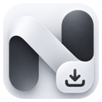

<p align="center"></p>

# NStore

Менеджер приложений iPhone и iPad для macOS на Apple Silicon.

[**Скачать последнюю стабильную версию →**](https://github.com/ascps/NStore-Releases/releases/latest)

NStore позволяет находить приложения в истории покупок Apple ID и списке с подключённого устройства, сохранять IPA на Mac и восстанавливать приложения по USB. Доступность загрузки зависит от лицензии учётной записи и серверов Apple.

## Возможности

- История покупок Apple ID и список приложений подключённого iPhone или iPad.
- Сохранение IPA в библиотеку на Mac и восстановление приложений по USB.
- Пакетные операции, очередь загрузок и история результатов.
- Импорт собственных IPA, выбор папки библиотеки и просмотр журнала.
- Общий аккаунт приложения и сайта, профиль, устройства и активация кодов.
- Автоматическая проверка, скачивание и установка стабильных обновлений при запуске.
- Trial, Home, Pro и индивидуальные условия Business; лимиты видны в личном кабинете.

[Сайт NStore](https://nstore.site) · [Личный кабинет](https://nstore.site/account)

[Подробная инструкция](USAGE.md)

## Установка

1. Откройте [Releases](https://github.com/ascps/NStore-Releases/releases/latest).
2. Скачайте файл `NStore-…-macOS-arm64.dmg`.
3. Откройте DMG и перенесите NStore в «Программы».

Требуется macOS 14 или новее, Mac с Apple Silicon (M1 и новее). Для установки на iPhone/iPad подключите устройство по USB, разблокируйте его и подтвердите доверие.

Текущие сборки имеют локальную подпись ad hoc, без нотарификации Apple. macOS может потребовать отдельного подтверждения запуска через «Системные настройки → Конфиденциальность и безопасность». Не отключайте Gatekeeper целиком. [Инструкция Apple](https://support.apple.com/ru-ru/102445).

## Обновления

Начиная с 0.4.0 приложение проверяет стабильные релизы, скачивает обновление, заменяет приложение и перезапускается. Текущие операции сначала завершаются. Проверяются отдельная криптографическая подпись обновления, SHA-256 и целостность приложения; при сбое запуска восстанавливается предыдущая версия. Автоматику и частоту проверки можно изменить в настройках.

При переходе с 0.3.0 и более ранних версий установите 0.4.0 через DMG один раз. Для последующих автоматических обновлений NStore должен находиться в доступной для записи папке, например «Программы». Системное подтверждение macOS при необходимости сохраняется.

В релизе публикуются описание изменений, DMG, файл `.sha256` и `NStore-update.json`. Проверка вручную:

```sh
shasum -a 256 -c NStore-ВЕРСИЯ-macOS-arm64.dmg.sha256
```

Этот публичный репозиторий содержит готовые стабильные версии и документацию. Исходный код и тестовые сборки разрабатываются отдельно. Приложение включает сторонние инструменты; их лицензии доступны в «Настройки → О программе → Инструменты и лицензии» и внутри пакета приложения.

## Почему в Assets есть Source code?

GitHub автоматически добавляет ZIP и TAR.GZ содержимого **этого публичного репозитория**. Здесь находятся только описание, инструкция и изображения. Исходники приложения разрабатываются отдельно в приватном репозитории и в эти архивы не входят. Для установки скачивайте файл `.dmg`.

## Тарифы

| Тариф | Цена | Компьютеры | Разные приложения | Срок |
| --- | --- | --- | --- | --- |
| Trial | 0 ₽ | 1 | 5 | 3 дня |
| Home | 490 ₽ | 1 | 10 | До исчерпания лимита |
| Pro | 2990 ₽ | 1 | Безлимит | 30 дней, разовая оплата |
| Business | Индивидуально | 1–10 | Безлимит | По согласованию |

Повторное получение того же приложения не расходует новое место. После исчерпания Trial/Home скачивание и установка недоступны до продления. Оплата на сайте пока не подключена; доступ выдаёт администратор. [Тарифы и условия](https://nstore.site/plans).

## Данные

Для проверки обновлений NStore обращается к публичному GitHub. Данные Apple ID, пароли и список устройств в запрос проверки обновлений не включаются. Пароль Apple ID не сохраняется приложением. Используемые инструменты и их лицензии поставляются с приложением.

## Разработчик

Роман Головков · [Telegram: @buuded](https://t.me/buuded)

© 2026 Роман Головков. NStore | Roman G. | buuded.
